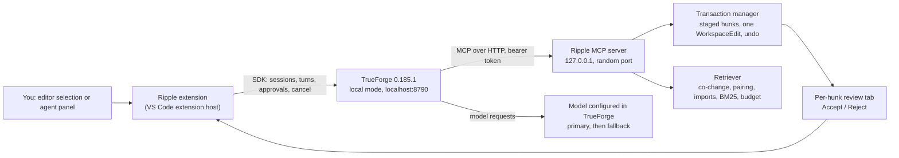

# Ripple

**A VS Code coding agent whose agent loop runs on TrueForge, and which never lets an edit reach disk until you have reviewed it hunk by hunk.**

[](https://youtu.be/ZeoBrU6ugYo)
[](docs/writeup.pdf)


Round 1 submission for the TrueFoundry Forge-a-thon (Techfest IIT Bombay 2026–27). Submitted code: commit [`491c092`](https://github.com/Sivaguru-2008/ripple/commit/491c092).

Ripple is a VS Code extension and a TrueForge client. It creates TrueForge sessions, streams the turn events into an agent panel, and serves the editor's capabilities (read, search, retrieve, propose a write, run a command) to the agent as MCP tools. The agent decides what to read and change; the extension decides nothing on its behalf and never calls a model provider. Every proposed change is staged in memory, opened as a per-hunk review when TrueForge pauses for tool approval, and written as one undoable `WorkspaceEdit` only after you accept it. When the configured model fails, a second configured model takes over without any action from you, and the workspace stays unchanged.

**Watch:** [demo video, 3:56](https://youtu.be/ZeoBrU6ugYo) · **Read:** [write-up PDF](docs/writeup.pdf) · [architecture](docs/architecture.md) · **Run:** [judge walkthrough](docs/judge-walkthrough.md)

---

## What is different

| | Ripple | A typical coding assistant |
|---|---|---|
| **Fenced edit transactions** | No tool writes to disk. Edits are staged, reviewed hunk by hunk, and written as one `WorkspaceEdit`; one undo restores every file a run changed. Hunk IDs hash the base text, range and new text, so a retried or stale proposal fails cleanly instead of corrupting the file. | Writes files directly, or shows a whole-file diff to accept or reject. |
| **Context receipt** | `retrieve_context` ranks files by git co-change, test and doc pairing, import neighbours and BM25 lexical matches, packs them into a hard token budget, and returns a receipt: each file, why it was chosen, the evidence, its tokens, and what was evicted. The receipt is shown in the panel. | Opaque context selection. |
| **TrueForge-native** | Sessions, streamed turn events, per-tool approval, cancel and compaction all come from TrueForge. Approval of `propose_write` is what opens the diff review. Model fallback starts a new TrueForge session on the second configured model. | Its own agent loop and model client. |

## Architecture



The extension never talks to a model. Details and a sequence diagram: [docs/architecture.md](docs/architecture.md).

## What a judge can verify

Video timestamps refer to the submitted [3:56 demo](https://youtu.be/ZeoBrU6ugYo) and were checked frame by frame. "Automated" means the repository's own end-to-end check (`npm run task-a`, `task-b`, `task-c`) in a real VS Code window on a fresh `pallets/flask` 3.1.3 clone.

| Task | What to look for | In the video | Evidence |
|---|---|---|---|
| **A. Inline edit** (`get_debug_flag`) | 2-hunk diff in the editor, each hunk with its own Accept / Reject; `FLASK_DEBUG=off` prints `False`; one undo, `git status` clean | diff 00:32, verify 00:50, undo 01:00; a reject is shown at 03:42 | Automated check passed on 18 Nov ([AGENTS.md §11](AGENTS.md#11-status)), and again after submission from a fresh clone of this repository (21 Nov, [walkthrough](docs/judge-walkthrough.md#evidence)) |
| **Cancel** | Tokens stream, then cancel ends the run and `git status` is clean | 01:08 to 01:16 | Cancel ended the turn in 11 to 36 ms with `git status` clean (16 Nov, [AGENTS.md §11](AGENTS.md#11-status)) |
| **B. Agent mode** (no files named) | Receipt with a reason per file; approval pause opens the review; the agent edits `src/flask/cli.py`, `tests/test_cli.py`, `docs/cli.rst`; TrueForge session with turns and tool calls; `pytest tests/test_cli.py -q` passes; `flask config` prints masked JSON; one undo restores all three files | prompt 01:24, review 01:34, compaction 01:50, three files 02:04, TrueForge session 02:12 and all tool calls with the compaction step 02:18 (22 Nov rerun, same model), tests 02:30, JSON 02:42, undo 02:58 | Passed 3 times on `gemini-3.1-flash-lite`, finished once by the fallback model, failed 3 times (17–18 Nov); on 22 Nov failed once and passed once ([write-up §8](docs/writeup.md#8-known-limitations)). That is not a pass rate. |
| **C. Resilience** | Primary model unreachable; the fallback model takes over with no click; editor responsive; `git status` clean during the review and after reject | endpoint stopped 03:06, fallback 03:16, clean 03:38 and 03:44 | Automated check passed on 18 Nov and again after submission (21 Nov): fallback to `ollama/qwen-coder-tools-7b`, longest extension-host stall 235 ms |

## Quick start

Full steps, what to look for, and troubleshooting: **[docs/judge-walkthrough.md](docs/judge-walkthrough.md)**.

Prerequisites: VS Code 1.95+, Git, Node.js 22+, Python 3.10+ with `pytest` and Flask's dependencies, a key for at least one model provider (Gemini's free tier works), and optionally [Ollama](https://ollama.com) for the local fallback model.

```powershell
git clone https://github.com/Sivaguru-2008/ripple.git
cd ripple
npm install
Set-Content -Path ".env" -Value "GEMINI_API_KEY=<your key>"   # git-ignored; read only by the setup script
npm run demo:prepare    # clones pallets/flask 3.1.3 into ../flask-demo and writes .env.demo
npm run stack           # TrueForge 0.185.1 on localhost:8790 + model adapter + model registration
```

Then open this folder in VS Code, pick the launch configuration **Run Ripple on the Flask demo**, and press **F5**.

- **Inline edit:** select code, press `Ctrl+;` (macOS `Cmd+Alt+R`), type an instruction.
- **Agent mode:** open the Ripple view in the activity bar and type a request.
- **Cancel:** `Ctrl+Alt+Backspace` or the panel's Cancel button. **Undo:** `Ripple: Undo Last Applied Change` or the panel's Undo Edit button.

**Using a different model.** Nothing is tied to Gemini. Register any provider in TrueForge (its UI, or a git-ignored copy of [`config/trueforge.models.example.json`](config/trueforge.models.example.json) as `config/trueforge.models.json`, then `npm run models`), set `model.name` to `<provider>/<model>` in [`agents/ripple-inline.json`](agents/ripple-inline.json) and [`agents/ripple-agent.json`](agents/ripple-agent.json), and set the VS Code setting `ripple.fallbackModel` for the second model.

## Security and privacy

- **No direct model calls.** The extension talks only to TrueForge on `localhost` through `@truefoundry/trueforge-sdk`. Models are configured in TrueForge; the optional adapter (`scripts/gemini-proxy.mjs`) is a separate local process registered in TrueForge as an OpenAI-compatible endpoint, not part of the extension.
- **Keys stay out of the extension and the repository.** Keys live in a git-ignored `.env` that only `scripts/setup-models.mjs` reads, to register providers in TrueForge. The repository ships only `config/trueforge.models.example.json`, with `${NAME}` placeholders.
- **The MCP server is local and authenticated.** It listens on `127.0.0.1` on a random port, requires a 32-byte random bearer token (compared in constant time), and serves each run at its own URL token; calls from a run that has ended are rejected and change nothing.
- **Workspace writes go through review.** `propose_write` and `replace_selection` only stage hunks; nothing is written until you accept. File tools refuse paths outside the workspace, the `.git` directory, and root-level `.env` files.
- **Commands need your approval.** `run_command` pauses for approval every time. Once approved it runs as a normal shell command in the workspace root, so read what you approve.

## Known limitations

- **Task B pass rate is not established.** On free Gemini Flash-Lite it passed 3 times, was finished once by the fallback model, and failed 3 times. A run takes 5 to 16 minutes and 70 to 160 model requests; free daily quotas allow about 3 runs per model per day.
- **Small local models** do Task A but not Task B.
- **Gemini, Groq and OpenRouter need the adapter running** (`npm run stack` starts it).
- **Tested on Windows only.** TrueForge is pinned to 0.185.1.
- **One automated check is flaky**: VS Code's own undo command depends on window focus.

More, with what another month would add: [write-up §8](docs/writeup.md#8-known-limitations).

## Repository map

```
agents/            TrueForge agent definitions used in the demo (inline and agent mode)
config/            example model providers (no keys); Ollama Modelfile for the fallback model
docs/              write-up (md + PDF), architecture, judge walkthrough, runbook, validation report
scripts/           stack start-up, model registration, model adapter, demo preparation and recording
src/core/          transactions, retrieval, budget, search, paths: no vscode imports, unit-tested
src/mcp/           MCP server and tool handlers
src/trueforge/     SDK client, turn streaming, approvals, retry and fallback
src/ui/            agent panel, per-hunk review, decorations and CodeLens
test/              168 vitest unit tests; integration/ holds the Task A, B, C runners
```

## Credits and licences

- Ripple is licensed under the [MIT License](LICENSE). It was built from scratch, not forked.
- Two editor files adapt code from [Continue](https://github.com/continuedev/continue) at commit `5522c6f44ca0ac3528b37244818fbfa39b5af470`, under the [Apache License 2.0](licenses/Apache-2.0.txt). They keep their licence headers:
  - `src/ui/decorations.ts`: the green and red line decorations, with added index guards and disposal.
  - `src/ui/hunkCodeLens.ts`: the per-hunk CodeLens, rewired to Ripple's hunk IDs (`ripple.acceptHunk`, `ripple.rejectHunk`), with file-level batch review added.
- Continue's agent loop, state and model clients are not used. The agent loop is TrueForge.
- Runtime dependencies: `@truefoundry/trueforge-sdk` 0.185.0, `@modelcontextprotocol/sdk` 1.32.2, `zod` 4.6.7 (all MIT).
- Built with Claude Code and Antigravity as coding assistants (declared in the write-up).
