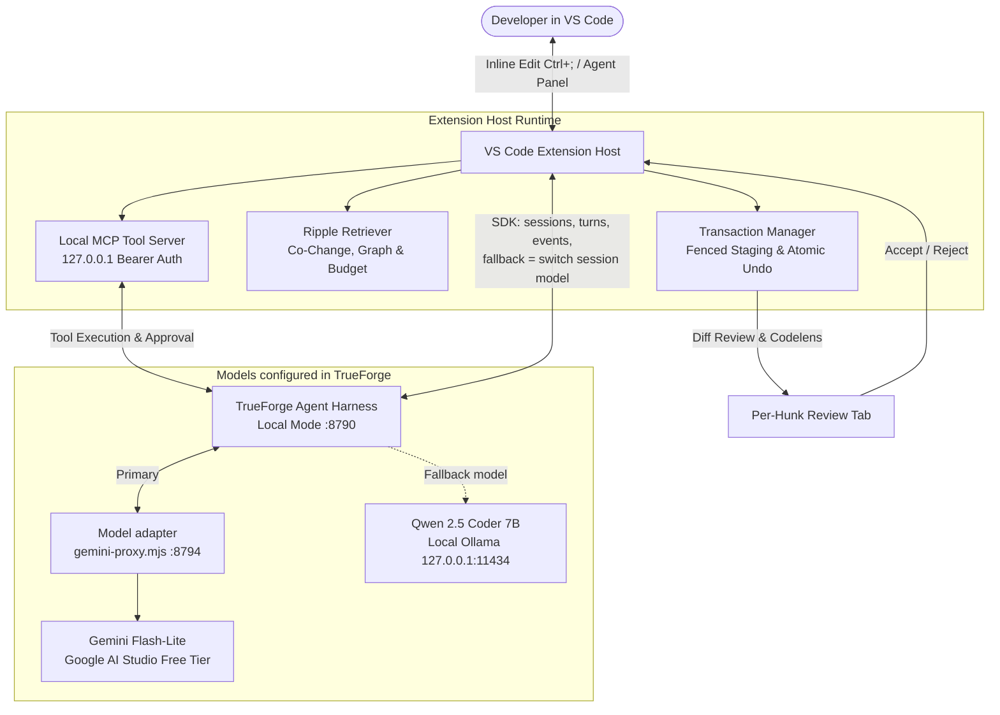

# Ripple

> **Editor-native coding agent powered by TrueForge**  
> *Round 1 Submission for TrueFoundry Forge-a-thon (Techfest IIT Bombay 2026–27)*


-teal?style=flat-square)

---

## 1. What is Ripple?

Most AI coding agents write directly to disk, pull entire repositories blindly into model contexts, or break down completely when an API rate limit or outage occurs.

**Ripple** is a Visual Studio Code extension that makes autonomous agent workflows **controllable, observable, and resilient**:

* **Trust the workflow. Not just the model.**

### Three Architectural Pillars

1. **Fenced Edit Transactions (Diff Safety & Undo)**
   * **Zero direct writes to disk.** Every modification is staged in an in-memory buffer.
   * **Per-hunk review in editor diff tabs.** The developer inspects and accepts or rejects each change independently.
   * **Atomic WorkspaceEdit & one-step undo.** Multi-file modifications apply as a single atomic batch that reverts completely with one standard Undo action (`Ctrl+Z`).
   * **Idempotent hunk hashing.** Hunk ID = `SHA256(base_text, range, new_text)`. Retries and stale proposals fail cleanly without corrupting the workspace.

2. **Ripple Retrieval & Context Receipts (Transparency)**
   * **Explainable file discovery.** When the user names no files, Ripple ranks candidates using:
     1. **Git co-change history** (files that frequently commit together in past PRs).
     2. **Test & doc pairing** (by naming convention and import graph neighbors).
     3. **BM25-style lexical matching** against symbols and task descriptions.
   * **Strict Token Budget Packing.** Generates structural definition maps rather than raw file dumps (saving up to 60% of context tokens).
   * **Inspectable Context Receipt.** The agent panel shows an exact receipt of which files were selected, why they were chosen (with co-change commit counts), and what was evicted.

3. **TrueForge-Native Agent Loop (Harness Integration)**
   * **Local Harness Mode.** The agent loop runs entirely on TrueForge (`@truefoundry/trueforge@0.185.1`). The extension never calls any AI model provider directly.
   * **Embedded MCP Tool Server.** Exposes editor capabilities (`read_file`, `search_workspace`, `retrieve_context`, `propose_write`, `run_command`) over `127.0.0.1` with bearer token authentication.
   * **Approval-Gated Tool Lifecycles.** TrueForge's `tool.approval_required` event triggers the inline diff review; human approval resumes the turn.
   * **Context Compaction.** TrueForge summarizes older turns when the thread crosses 20,000 input tokens (`agents/ripple-agent.json`).
   * **Automatic Multi-Model Failover.** If the primary model (Gemini 3.5 Flash-Lite for inline edits) fails or hits a rate limit, Ripple retries once, then switches the TrueForge session to a second configured model (`ripple.fallbackModel`, by default Qwen 2.5 Coder 7B on Ollama) without user action or workspace changes.

---

## 2. System Architecture



---

## 3. Quick Start (From a Clean Clone)

Follow this setup to run Ripple from scratch. Full operational runbook: [docs/runbook.md](docs/runbook.md).

### Prerequisites
- VS Code 1.95+, Git, Node.js 22+ or 24+
- Python 3.10+ with `pytest` and Flask's dependencies (`python -m pip install pytest werkzeug jinja2 click itsdangerous blinker`)
- (Optional, for the local fallback model) [Ollama](https://ollama.com), then:
  ```powershell
  ollama pull qwen2.5-coder:7b
  ollama create qwen2.5-coder-tools:7b -f config/ollama/qwen2.5-coder-tools.Modelfile
  ```
  The Modelfile only changes the chat template so the 7B model returns real tool calls.

### 1. Clone & Install Dependencies
```powershell
git clone https://github.com/Sivaguru-2008/ripple.git
cd ripple
npm install
```

### 2. Configure Model Credentials
Keys are read from a git-ignored `.env` file (never committed):
```powershell
# Create .env in root
Set-Content -Path ".env" -Value "GEMINI_API_KEY=your_gemini_api_key_here"
```
*(You can obtain a free key at [Google AI Studio](https://aistudio.google.com/)).*

**Using a different model.** Ripple is not tied to Gemini. Add your provider to a copy of the example config (`config/trueforge.models.json`, git-ignored; keys as `${NAME}` from `.env`), or add it in the TrueForge UI, then set `model.name` (`<provider>/<model>`) in `agents/ripple-inline.json` (inline edits) and `agents/ripple-agent.json` (agent mode), and the VS Code setting `ripple.fallbackModel` for the second model. Any OpenAI-compatible endpoint registered in TrueForge works.

### 3. Prepare the Demonstration Repository
Clone `pallets/flask` at pinned release tag `3.1.3` (commit `22d92470`):
```powershell
npm run demo:prepare
```

### 4. Start the TrueForge Stack
In a dedicated terminal, launch TrueForge and the model adapter:
```powershell
npm run stack
```
*Starts TrueForge on `http://localhost:8790` with loopback whitelist enabled (`OUTBOUND_URL_ALLOWED_HOSTS='["127.0.0.1"]'`), boots the adapter, and registers model definitions.*

### 5. Launch Ripple in VS Code
Open this folder in VS Code, choose the launch configuration **Run Ripple on the Flask demo** in the Run and Debug view, and press **F5**. (The first configuration, *Run Ripple*, opens this repository instead of the Flask clone.) A second VS Code window opens on `../flask-demo` with Ripple loaded.
- Open any file in the workspace (e.g. `src/flask/helpers.py`).
- Select code and press `Ctrl+;` for inline edit.
- Click the Ripple icon in the sidebar to open the Agent Panel.

---

## 4. Verification Suite (The Three Fixed Tasks)

The competition evaluation tests Ripple against `pallets/flask` (tag 3.1.3):

### Task A — Inline Edit (Control)
- **Action:** Open `src/flask/helpers.py`, select `get_debug_flag`, press `Ctrl+;`, and instruct:
  > *"Treat the values 'off' and 'n' as false as well, case-insensitively, and update the docstring to list every value that is treated as false."*
- **Review:** Accept hunks in the diff review tab.
- **Verification** (in `../flask-demo`):
  ```powershell
  $env:PYTHONPATH="src"; $env:FLASK_DEBUG="off"; python -c "from flask.helpers import get_debug_flag; print(get_debug_flag())"
  # Output: False   (bash: PYTHONPATH=src FLASK_DEBUG=off python -c "...")
  ```
- **Undo:** Run `Ripple: Undo Last Applied Change` (or the Undo button in the agent panel). The file reverts in one step; `git status` is clean.

### Task B — Agent Mode (Transparency & Multi-File Discovery)
- **Action:** In the agent panel, with **no files named**, instruct:
  > *"Add a new built-in CLI command flask config that prints the loaded application's configuration as JSON, masking the values of any key containing SECRET, PASSWORD, TOKEN or KEY as '***'. It must appear in flask --help, be covered by a test, and be documented alongside the other built-in commands."*
- **Outcome:**
  - Ripple retrieves context and shows the **Context Receipt** in the panel.
  - Automatically identifies and edits **3 files**: `src/flask/cli.py`, `tests/test_cli.py`, and `docs/cli.rst`.
  - TrueForge compacts the thread once it passes 20,000 input tokens.
- **Verification:**
  ```powershell
  pytest tests/test_cli.py -q
  # Output: 59 passed
  ```
- **CLI Output:**
  ```powershell
  flask config
  # Output: {"SECRET_KEY": "***", "DEBUG": false, ...}
  ```
- **Rollback:** One undo restores all 3 files together; `git status` returns to clean.

### Task C — Resilience & Automatic Local Fallback
- **Action:** Make the primary model unreachable (stop the adapter, or point the provider at an unreachable endpoint or an invalid key in TrueForge), then repeat Task A.
- **Outcome:**
  - The turn ends with a model error in TrueForge; Ripple retries once, then switches the session to the fallback model (`ripple.fallbackModel`, default `ollama/qwen-coder-tools-7b`) with no user action.
  - Editor never blocks; diff tab opens with proposed edit from the local model.
  - Rejecting the proposal leaves the repository completely untouched (`git status` clean).

Automated end-to-end evaluators:
```powershell
npm run task-a    # Runs Task A automated evaluation in clean host
npm run task-b    # Runs Task B multi-file automated evaluation
npm run task-c    # Runs Task C failover evaluation
```

---

## 5. Competition Scorecard & Video Timestamps

Demonstrated in the submission video, **[youtu.be/SXWVulFGhJc](https://youtu.be/SXWVulFGhJc)** (runtime 3:53, under 4 min):

| Criterion | Video Time | Verified Claim & Evidence |
|---|---|---|
| **A1 Inline Edit (10 pts)** | `00:54` | Task A diff in the editor: 2 hunks, each with its own Accept/Reject (a reject is used at 03:38); `FLASK_DEBUG=off` → `False` at 01:11. |
| **A2 Agent Mode (10 pts)** | `02:15` | Prompt at 01:39 names no files; the agent found and edited `cli.py`, `test_cli.py`, `cli.rst`. |
| **A3 Streaming & Cancel (10 pts)** | `01:19` | Tokens stream; cancel at 01:24 ends the turn (16–35 ms in tests); `git status` clean. |
| **B1 Context Assembly (15 pts)** | `01:39` | Budgeted map retrieval; the receipt shows each file, why it was chosen (git co-change counts), tokens and evictions. |
| **B2 Diff Safety (10 pts)** | `00:54` | Nothing written before acceptance; one undo restores the file (01:18) and all three Task B files (02:49). |
| **B3 Resilience (10 pts)** | `03:26` | Gemini endpoint stopped (02:59); retry, then the local Qwen 7B takes over with no user action; `git status` clean (03:33, 03:38). |
| **B4 TrueForge Depth (10 pts)** | `02:06` | MCP tools over loopback; approval pause opens the review; compaction starts (02:06); TrueForge session with turns and tool calls (02:23). |
| **C1 Demo Video (10 pts)** | `00:00` | Tasks A (00:34), B (01:32), C (02:59) in order, each verified on screen; pytest and masked JSON at 02:40–02:47; 3m 53s. |
| **C2 Write-up (15 pts)** | — | [docs/writeup.pdf](docs/writeup.pdf): the 8 required headings, design decisions with their costs, scorecard, limitations. |

---

## 6. Project Layout

```
ripples/
├── agents/                       # Pinned TrueForge agent specs
│   ├── ripple-agent.json         # Full multi-file agent (compaction threshold: 20k)
│   └── ripple-inline.json        # Lean inline-edit agent
├── config/
│   ├── trueforge.models.example.json  # Sanitized model provider template (zero secrets)
│   └── ollama/qwen2.5-coder-tools.Modelfile  # Local fallback model (tool-call template)
├── docs/
│   ├── writeup.md                # 8-heading competition write-up source
│   ├── writeup.pdf               # Compiled 2-to-3-page competition write-up PDF
│   ├── runbook.md                # Engineering runbook & troubleshooting manual
│   └── validation-report.md      # Full verification logs from clean runs
├── scripts/
│   ├── start-stack.mjs           # One-command boot for TrueForge + adapter + models
│   ├── gemini-proxy.mjs          # Multi-provider model proxy (streaming, keep-alive)
│   ├── setup-models.mjs          # TrueForge provider registration script
│   └── demo/                     # End-to-end video recording & editing automation
├── src/
│   ├── core/                     # Pure TypeScript, zero VS Code imports (unit-tested)
│   │   ├── transactions.ts       # Fenced edit buffers, epoch tracking, atomic undo
│   │   ├── retrieve.ts           # Co-change mining, pairing graph, lexical budget packer
│   │   └── budget.ts             # Adaptive context budget allocations
│   ├── mcp/                      # Embedded HTTP MCP Tool Server (loopback, bearer auth)
│   ├── trueforge/                # TrueForge SDK client, turn streaming, failover handler
│   └── ui/                       # Diff review tabs, CodeLens decorations, Agent Panel webview
└── test/                         # 168 Vitest unit tests (transactions, retrieve, mcp, fallback)
```

---

## 7. Starting Point & Open Source Attribution

Ripple was built from scratch and is **not a fork**. To ensure rock-solid in-editor UX, two UI components adapt code from [Continue](https://github.com/continuedev/continue) (commit `5522c6f44ca0ac3528b37244818fbfa39b5af470`, Apache License 2.0; see [licenses/Apache-2.0.txt](licenses/Apache-2.0.txt)):

1. `src/ui/decorations.ts`: Adapted line-level diff decorations (`green` / `red` gutter markers); added boundary index guards and lifecycle disposal.
2. `src/ui/hunkCodeLens.ts`: Adapted per-line CodeLens provider; rewired to Ripple's transaction hunk IDs (`ripple.acceptHunk`, `ripple.rejectHunk`) and added file-level batch review.

**Note:** Continue's agent loop, state manager, and model callers were completely excluded. The agent loop runs natively on **TrueForge**.

### Runtime Dependencies
- `@truefoundry/trueforge-sdk` (`0.185.0`) — MIT
- `@modelcontextprotocol/sdk` (`1.32.2`) — MIT
- `zod` (`4.6.7`) — MIT

---

## 8. License

This project is licensed under the **MIT License** — see [LICENSE](LICENSE).  
Adapted UI files remain under the **Apache License 2.0** ([licenses/Apache-2.0.txt](licenses/Apache-2.0.txt)).
