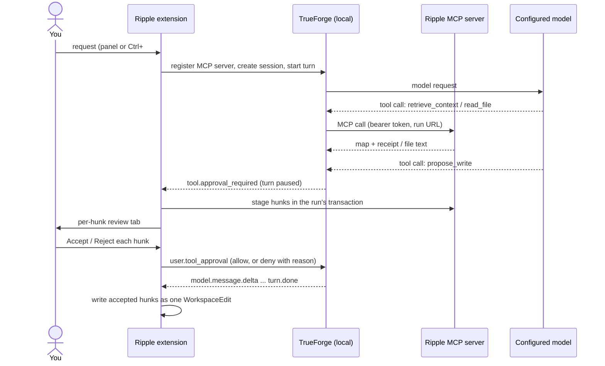

# Ripple architecture

Ripple is three things inside one VS Code extension: a TrueForge client, an MCP server that exposes the editor to the agent, and a transaction manager that keeps every edit staged until you accept it. TrueForge runs the agent loop. The extension never calls a model.

## The request path

```
VS Code panel or editor
  → Ripple extension host                (src/extension.ts, src/ui/)
  → local authenticated MCP server       (src/mcp/server.ts)
  → TrueForge session and turn stream    (src/trueforge/client.ts, runner.ts)
  → model provider configured in TrueForge
```

1. **You start a run.** Inline edit: select code and press `Ctrl+;`. Agent mode: type a request in the Ripple panel; `@file` and `@symbol` mentions are resolved and pinned.
2. **The extension opens a Ripple transaction** for the run and registers its MCP server with TrueForge (`settings.mcpServers.createOrUpdate`, header auth). Each run is served at its own URL token.
3. **It creates a TrueForge session** from the committed agent definition (`agents/ripple-inline.json` or `agents/ripple-agent.json`) and sends the request as a turn with `sessions.createTurnStream`.
4. **TrueForge runs the loop.** The model calls Ripple's MCP tools: `retrieve_context`, `read_file`, `search_workspace`, `propose_write` and `run_command` in agent mode; `replace_selection` in inline mode.
5. **Writes pause the turn.** `propose_write`, `replace_selection` and `run_command` are listed in `require_approval_for_tools`. TrueForge emits `tool.approval_required` and pauses; Ripple opens the per-hunk review in an editor tab. Your accept or reject becomes the approval (`sessions.createTurnEvents` with `user.tool_approval`), and rejected hunks are reported back to the agent with your reason.
6. **Streaming and cancel.** `model.message.delta` events stream into the panel and the progress notification. Cancel calls `sessions.cancel`; the transaction is rolled back, so nothing half-applied remains.
7. **The run ends.** Accepted hunks are written as one `WorkspaceEdit`, and `Ripple: Undo Last Applied Change` restores every file the run changed in one step.



## Design decision 1: staged hunks and one atomic `WorkspaceEdit`

**What:** no tool writes to disk. `propose_write` and `replace_selection` stage hunks in the run's transaction (`src/core/transactions.ts`). Each hunk ID is a SHA-256 hash of the base text, the range and the new text, so a retried proposal is idempotent and one made against text that has since changed fails cleanly. Accepted hunks across files are written as one `WorkspaceEdit`: either every file changes or none does, and one undo restores all of them.

**Fencing:** each run gets its own MCP URL token. Once a run is cancelled, fails or ends, calls that carry its token are rejected and change nothing. Line-number edits must quote the current text of their anchor line, so a stale line number fails instead of editing the wrong place.

**Cost:** the agent's tests need the files on disk, so accepted edits are written just before an approved test command runs. A cancel after that point rolls the transaction back.

## Design decision 2: a retrieval receipt instead of opaque context

**What:** `retrieve_context` (`src/core/retrieve.ts`) ranks files for the request without embeddings, using signals a person can check:

| Signal | Example evidence |
|---|---|
| Git co-change | "changed with src/flask/cli.py in 48 commits" |
| Test and doc pairing | `tests/test_cli.py` paired with `src/flask/cli.py` by name |
| Import neighbours | files that import, or are imported by, the strongest matches (both directions) |
| Lexical (BM25) | symbol and word matches from the request |
| Pinned | `@file` and `@symbol` mentions, always included |

The result is packed into a hard budget: at most 8,000 tokens and at most 30% of the model's context window (`src/core/budget.ts`). By default it sends a **map**: each file's definitions or doc sections with line ranges. The agent then reads only the ranges it needs (`read_file` returns at most 120 lines). In Task B the map of 6 files costs 2,038 tokens, against 4,655 tokens for 5 files as excerpts. Every result carries a **receipt** (file, reason, evidence, tokens, mode) and the list of **evicted** files with the reason; the panel shows both.

**Cost:** a file related only in meaning, with no shared history, name or words, is missed, and the map trades tokens for extra `read_file` round trips.

## Design decision 3: fallback through TrueForge, not direct provider calls

**What:** TrueForge 0.185.1 has no built-in model failover, so the runner (`src/trueforge/runner.ts`) handles it. When a turn ends with a model error:

1. A retryable error (timeout, overload, connection error) is retried once on the same model.
2. If it still fails, Ripple starts a **new TrueForge session** from the same agent definition with `model.name` set to `ripple.fallbackModel`, on the **same Ripple transaction**. Edits you already accepted are kept, and the new session is told what is already done.
3. If every attempt fails, the transaction is rolled back and you get a clear error.

All of this happens in TrueForge sessions; the extension still never calls a provider. The fallback model is any model registered in TrueForge, including a local Ollama model, which does not go through the adapter.

**Cost:** the failed model gets one retry before the switch, and the new session starts without the failed thread's conversation; only the continuation note carries the progress over.

## Harness features used

| TrueForge feature | Where |
|---|---|
| Sessions and streamed turns (SDK) | `src/trueforge/client.ts` |
| MCP connectors (remote, header auth) | registered per run; tools preloaded (`preload: true`) |
| Per-tool approval | `require_approval_for_tools` in both agent definitions |
| Cancel | `sessions.cancel` |
| Context compaction | `agents/ripple-agent.json`: `input_tokens` trigger at 20,000; each compaction is logged and shown in the panel, and the next `retrieve_context` starts with the changes already made |

Not used: subagents, deferred tool loading (tried, then replaced by preloading), Code Mode, skills, sandboxing.

## Pinned versions

TrueForge `0.185.1` (`npx @truefoundry/trueforge@0.185.1`), `@truefoundry/trueforge-sdk` 0.185.0, `@modelcontextprotocol/sdk` 1.32.2. Verified behaviour of each SDK call is recorded in [AGENTS.md §9](../AGENTS.md#9-open-rd-questions-answer-before-building-on-them-record-answers-here).
